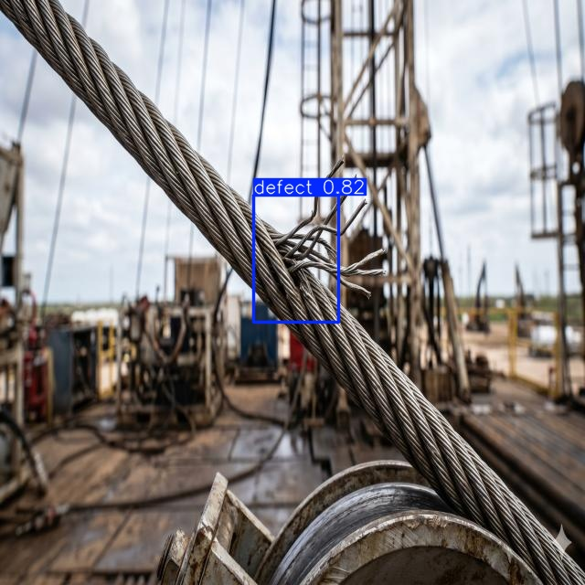
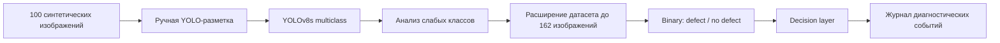
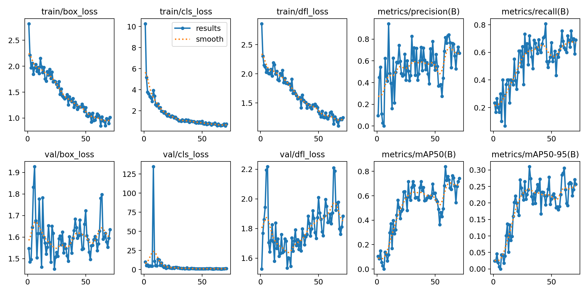
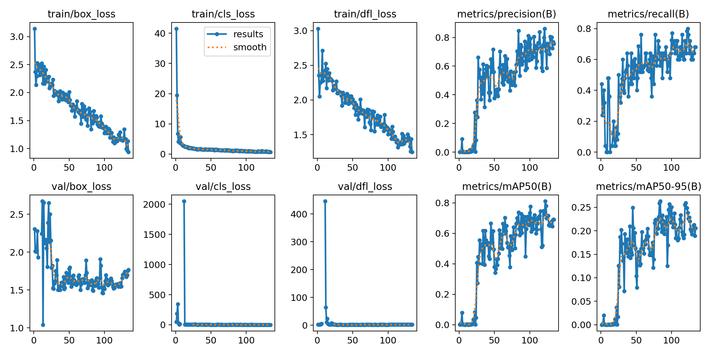
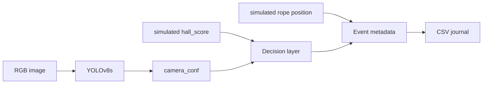

# Прототип системы дефектоскопии талевых канатов с использованием машинного обучения


Данная практическая часть проекта выполнялась в рамках магистерской диссертации по контролю состояния бурового талевого каната. Компьютерное зрение здесь — одна из подсистем более широкой диагностической системы для нефтегазовой отрасли.

| | |
|---|---|
| **ML-задача** | Object Detection |
| **Модель** | YOLOv8s |
| **Данные** | 162 синтетических RGB-изображения, 640×640 |
| **Разметка** | ручная bbox-разметка в Roboflow |
| **Стадия** | исследовательский программный прототип |

<p align="center">
  
</p>


## Ход работы




Первоначальная модель давала слишком неоднородное качество по классам, самым сложным оказался `broken_wire`. Отсюда вытекло решение расширять выборку неравномерно, делая упор на слабые группы. Однако для завершения прототипа оказалось достаточным обнаружение дефектного участка без обязательной классификации

Подобное изменение облегчило классификацию и обучение, корректным путём было бы значительное расширение датасета по каждому классу. А также добавление на эти же ракурсы других визуальных каналов, что в рамках работы оказалось избыточным


## Датасет

В финальную версию попало 162 синтетических изображения 640х640. Каждый bbox я размечал вручную в Roboflow. За отрицательный результат классификации была принята группа `normal`, отдельным классом она никогда не закладывалась


| Группа | Train | Val | Test | Всего |
|:---|---:|---:|---:|---:|
| `broken_wire` | 34 | 10 | 5 | 49 |
| `corrosion` | 18 | 5 | 2 | 25 |
| `kink_or_bend` | 35 | 10 | 5 | 50 |
| `normal` | 26 | 8 | 4 | 38 |
| **Всего** | **113** | **33** | **16** | **162** |


## Результаты

### Multiclass YOLOv8s — validation

| Класс | Precision | Recall | mAP@0.5 |
|:---|---:|---:|---:|
| `broken_wire` | 0.526 | 0.500 | 0.489 |
| `corrosion` | 0.790 | 0.760 | 0.866 |
| `kink_or_bend` | 0.498 | 0.900 | 0.793 |
| **Среднее** | **0.605** | **0.721** | **0.716** |

Наиболее проблемным оказался `broken_wire`, поэтому дополнительные изображения в первую очередь добавлялись для слабых групп.

### Binary YOLOv8s

| Оценка | Значение |
|:---|---:|
| Validation Precision | 0.847 |
| Validation Recall | 0.560 |
| Validation mAP@0.5 | 0.738 |
| Validation mAP@0.5:0.95 | 0.263 |
| Test: найдено дефектных изображений | 11 из 12 |
| Test: image-level Precision | 91.7% |
| Test: image-level Recall | 91.7% |
| Test: Accuracy | 87.5% |

Image-level результат получен на небольшом синтетическом test split из 16 изображений при пороге `camera_conf >= 0.35`. Он описывает наличие тревоги на изображении и не является метрикой локализации bounding box.

<p align="center">
  
  
</p>

Подробнее о конфигурации обучения и трактовке метрик — в [`docs/experiment.md`](docs/experiment.md).

## Decision layer

В практической части выход RGB-модели использовался как один из признаков диагностического события. Магнитный и координатный каналы в эксперименте моделировались программно.



Стартовыми порогами прототипа были 0.35 для визуального признака и 0.55 для магнитного. Дополнительно рассчитывался эвристический общий уровень риска.

$$
R = 0.60 \cdot C_{\text{camera}} + 0.40 \cdot S_{\text{hall}}
$$

ВАЖНО: `hall_score` в этой работе не является показанием физического датчика Холла — он генерировался программно. Из-за этого магнитный признак получался слишком предсказуемым и в текущей итерации не был независимым от тестового примера. Поэтому я сознательно ограничил его вес в итоговом risk score: 0.40 против 0.60 у визуального канала. Для реальной системы веса и пороги нужно калибровать заново по независимым данным физических датчиков.

Полная концепция системы — RGB/IR/UV-каналы, магнитный контроль, энкодер, edge-вычисления и журналирование — описана в [`docs/architecture.md`](docs/architecture.md).

## Ограничения эксперимента

- нет реальных изображений канатов
- датасет создавался примерно одним генеративным процессом
- на всех положительных изображениях есть только одна размеченная область
- split формировался автоматически и менялся при расширении набора
- тест маленький
- физических датчиков не было в работе
- параметры системы принятия решений не калибровались на физических данных
- реальных benchmark моделей YOLO не проводилось 

## Контекст работы

Идея проекта выросла из бакалаврской работы, где система рассматривалась в основном на концептуальном уровне. В магистерской диссертации **«Система контроля состояния бурового талевого каната»** задача была доведена до программного ML-прототипа: сформирован датасет, обучены модели, проверена логика объединения диагностических признаков и ведения журнала событий.

РГУ нефти и газа (НИУ) имени И. М. Губкина, 2026.

**Подробнее:** [ML-эксперимент](docs/experiment.md) · [Архитектура системы](docs/architecture.md)

<details>
<summary><strong>Локальный запуск</strong></summary>

Требуется Python 3.10+.

```bash
python -m venv .venv
python -m pip install -e ".[dev]"
python -m pytest -q
```

Проверка логики decision layer:

```bash
python -m rope_defect decide --camera 0.72 --hall 0.61
```

Для запуска YOLO требуется Ultralytics и локальный файл весов:

```bash
python -m pip install -e ".[yolo]"

python -m rope_defect predict \
  --weights models/binary.pt \
  --source data/sample/images \
  --output outputs/predict \
  --device cpu
```

Полный датасет и веса моделей в репозиторий не включены.

</details>