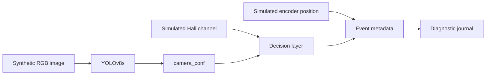
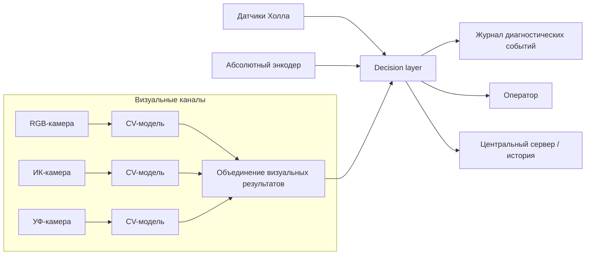

# Архитектура проекта

Фактическая система состоит из реально выполненного CV эксперимента и более широкой проектной концепции итоговой дефектоскопической системы

## Реализованный программный контур

Как описывалось раньше, из-за невозможности получения реальных данных визуальная часть была обучена на синтетических изображениях.

Магнитный канал и координатный канал энкодера моделировались программно

## Логика принятия решений

Параметры находятся в [`../configs/decision.yaml`](../configs/decision.yaml).

| Состояние | Условие |
|:---|:---|
| `NORMAL` | оба признака ниже порогов |
| `VISUAL_SUSPECT` | сработал только визуальный канал |
| `MAGNETIC_SUSPECT` | сработал только магнитный канал |
| `CONFIRMED_DEFECT` | оба канала выше своих порогов |
| `CRITICAL_DEFECT` | оба канала и общий risk score выше порогов|

Использованные пороги:

- visual threshold — `0.35`;
- magnetic threshold — `0.55`;
- critical risk threshold — `0.75`.

Интегральный риск:

$$
R = 0.60 \cdot C_{\text{camera}} + 0.40 \cdot S_{\text{hall}}
$$

В реальной системе требуется перекалибровка

### Смоделлированные каналы

Симулированный `hall_score` в этой итерации зависит от известного типа тестового изображения и частично от уже полученного `camera_conf`. Поэтому магнитный канал здесь используется только для демонстрации логики принятия решения и не является по-настоящему независимым. В реальной системе данные датчиков Холла должны поступать как отдельный физический измерительный канал.

## Более широкая концепция ВКР

Настоящая система у меня закладывала в себя больше интересных вещей:

### RGB / IR / UV

Во-первых, я хотел использовать не один визуальный канал, а три разных типа камер, каждая из которых давала бы свой тип информации о состоянии каната.

- **RGB** — наружные дефекты, обрывы проволок, коррозия, геометрические повреждения;
- **ИК** — температурные аномалии, потенциально связанные с трением и внутренними проблемами;
- **УФ** — дополнительный канал для поверхностных аномалий и контроля покрытия при подходящей технологии.

Итоговое решение в идеальной системе должно было приниматься на основе голосвания моделей, где каждая была бы обучена под все виды дефектов

### Система датчиков Холла

Магнитная сторона описана в моей работе с физической точки зрения, и должна была быть независимым физическим каналом. Однако на практике доступа к материалу для тестирования не оказалось, поэтому было принято решение его моделировать

### Энкодер

Абсолютный оптический энкодер в системе используется как источник координаты. Зная положение каната и расстояние между измерительными постами, можно синхронизировать результаты разных каналов, которые в один момент времени наблюдают разные участки, и связать их с одним физическим участком каната.

### Edge-вычисления / Jetson

В полной архитектуре основную обработку предполагалось выполнять непосредственно на периферийном узле рядом с измерительными каналами, а не отправлять весь исходный поток данных на удалённый сервер.

Такой подход нужен по двум причинам: система должна продолжать принимать решения при нестабильной связи, а передавать на сервер выгоднее уже сформированные диагностические события, изображения подозрительных участков и метаданные, а не непрерывный видеопоток.

В качестве возможной аппаратной платформы в работе рассматривался NVIDIA Jetson Orin Nano. Развёртывание модели на Jetson в рамках программного прототипа не выполнялось.

## Граница между прототипом и проектной концепцией

| Компонент | Статус |
|:---|:---|
| RGB YOLOv8s | реализовано и обучено |
| ручная bbox-разметка | реализовано |
| binary decision from camera confidence | реализовано |
| Hall score | программная симуляция |
| координата каната | программная симуляция |
| диагностический CSV-журнал | реализовано |
| ИК / УФ модели | концепция |
| физические датчики Холла| концепция |
| физический энкодер | концепция |
| развёртывание на Jetson| концепция |
| центральный сервер | архитектурная концепция |

[← Вернуться к README](../README.md)